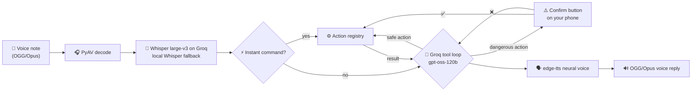
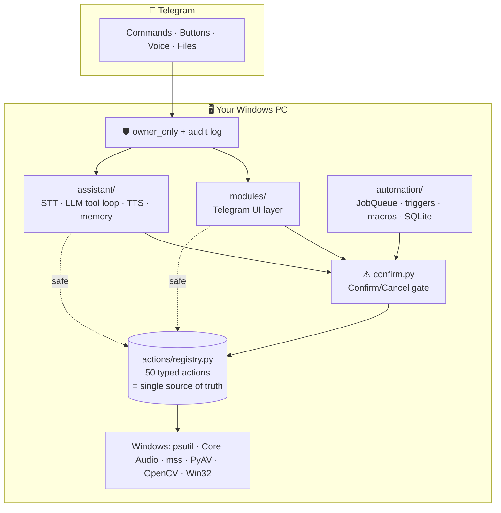

<div align="center">



<br>

**Talk to your PC from anywhere.** Send a voice note: *"Edith, close Chrome, turn the volume down and lock the screen."*<br>
Your PC does it, then answers you out loud.

<br>

[](https://www.python.org/)
[](#1-get-running-in-5-minutes)
[](https://core.telegram.org/bots)
[](https://python-telegram-bot.org/)
[](#1-get-running-in-5-minutes)
[](#-development)
[](LICENSE)

[Get started](#1-get-running-in-5-minutes) · [Talk to Edith](#2-three-ways-to-talk-to-edith) · [Instant commands](#3-instant-commands-no-ai-needed) · [Macros](#6-teaching-edith-tasks-with-macros) · [Automations](#7-reminders-schedules-and-triggers) · [All commands](#8-every-slash-command) · [Safety](#9-safety-confirm-guardrails-and-your-own-rules) · [Troubleshooting](#12-troubleshooting)

</div>

---

## ✨ Why Edith?

<table>
<tr>
<td width="33%" valign="top">

### 🎙 Talk, don't type
Send a **voice note**. Edith transcribes it with **Whisper large-v3**, works out the steps, runs them and **replies with her own voice**.

</td>
<td width="33%" valign="top">

### 💬 Just say it or type it
No slash commands needed: plain chat messages and voice notes both work. Common commands run **instantly**, with no AI call.

</td>
<td width="33%" valign="top">

### 🛡 Paranoid by default
Only **your** Telegram account can use it, and strangers get silence. Anything destructive needs a **✅ Confirm** tap, even when the AI asks.

</td>
</tr>
<tr>
<td valign="top">

### ⚡ 74 actions, one registry
Every feature is a typed action. Slash commands, buttons, the AI and automations all call the **same** code.

</td>
<td valign="top">

### ⏰ Automations
Reminders, `/every 30m`, `/at 22:00`, triggers like **`cpu>90 for 2m`** or **`battery<20`**, plus macros. Saved in SQLite, so they survive restarts.

</td>
<td valign="top">

### 🧰 Zero-config install
Double-click `setup.bat`. Python, packages, bot token, **auto-detection of your Telegram ID**: done in one go.

</td>
</tr>
</table>

## 💬 What it feels like

```text
You    🎤 (voice) "Edith, what's eating my RAM? Kill the worst one."
Edith  Chrome is using 6.1 GB across 38 processes. Shall I end it?
       ⚠️ Confirm?  kill_process(target='chrome.exe')   [✅ Confirm] [❌ Cancel]
You    ✅
Edith  🔊 "Done. Chrome is closed, and you've got 9 GB free now."

You    /at 23:30 daily power_shutdown
Edith  ⚠️ Confirm? Schedule power_shutdown daily at 23:30   [✅ Confirm] [❌ Cancel]

You    /when battery<20 notify text=Plug me in
Edith  🔔 Trigger armed: battery < 20%
```
<sub>An illustrative conversation; exact wording varies with the AI model you pick.</sub>

## 📘 Contents

1. [Get running in 5 minutes](#1-get-running-in-5-minutes)
2. [Three ways to talk to Edith](#2-three-ways-to-talk-to-edith)
3. [Instant commands (no AI needed)](#3-instant-commands-no-ai-needed)
4. [Asking Edith anything](#4-asking-edith-anything)
5. [Doing several things in a row](#5-doing-several-things-in-a-row)
6. [Teaching Edith tasks with macros](#6-teaching-edith-tasks-with-macros)
7. [Reminders, schedules and triggers](#7-reminders-schedules-and-triggers)
8. [Every slash command](#8-every-slash-command)
9. [Safety: Confirm, guardrails and your own rules](#9-safety-confirm-guardrails-and-your-own-rules)
10. [The control panel on your PC](#10-the-control-panel-on-your-pc)
11. [Settings reference](#11-settings-reference)
12. [Troubleshooting](#12-troubleshooting)
13. [What Edith can't do (yet)](#13-what-edith-cant-do-yet)
14. [For developers](#-for-developers)

---

## 1. Get running in 5 minutes

You need Windows 10/11 and Telegram on your phone.

1. **Create your bot.** In Telegram, open **@BotFather**, send `/newbot`, pick a name and a username ending in `bot`, and copy the token it gives you.
2. **Get a free Groq key** at [console.groq.com/keys](https://console.groq.com/keys) → *Create API Key* (it starts with `gsk_`). This one key powers both Edith's hearing and her thinking.
3. **Install.** Download the latest `Edith-…-windows.zip` from [**Releases**](https://github.com/Arnab-apk/edith/releases/latest), extract it (for example to `D:\Edith`), and double-click **`Edith.exe`**. The wizard:
   - asks for the bot token and checks it with Telegram,
   - tells you to press **START** on your bot from your phone, then links your Telegram account automatically,
   - asks for the Groq key and tests it with a real question.
4. **Start.** From then on, double-click `Edith.exe` and keep its window open. You get *"✅ … is online"* in Telegram.
5. **Try it.** Send `/help`, then hold the mic button and say *"take a screenshot"*.

> Windows may show a SmartScreen warning because `Edith.exe` isn't code-signed. Click **More info → Run anyway**.

---

## 2. Three ways to talk to Edith

All three do the same thing. Use whichever is handiest.

| Way | Example | Notes |
|---|---|---|
| 🎙 **Voice note** | hold the mic, say *"Edith, lock my PC"* | Edith shows what she heard, then does it. She also answers out loud if `/voice on` is set. |
| 💬 **Plain message** | `what's using my RAM?` | No slash needed. |
| ⌨️ **Slash command** | `/status`, `/volume 30` | Precise, and never goes through the AI. |

**Voice tips**
- Speak naturally. "Edith", "hey Edith", "please" and "can you" are ignored, so *"hey Edith, could you lock the PC please"* works.
- Short commands work best when you speak clearly. Edith always shows **🎙 what she heard**, so you can see if she misheard.
- `/voice off` gives text-only answers (faster). `/voice on` adds spoken replies, which are kept short; the full answer is always in the text.

---

## 3. Instant commands (no AI needed)

These phrases are recognised on your PC and run immediately: no AI call, no rate limit, works even if Groq is down. Many variations work; here are tested examples.

| You say | Edith does |
|---|---|
| "lock the PC" · "lock my laptop" · "lock the screen" | locks Windows |
| "screenshot" · "send me a screenshot" · "show me my screen" | sends a screenshot of all monitors |
| "set volume to 30" · "volume forty-five" · "fifty percent volume" | sets the volume |
| "volume up" · "louder" · "turn the sound down by 5" · "max volume" | changes the volume |
| "mute" · "unmute" · "toggle mute" · "what's the volume" | mute control |
| "pause" · "play" · "next song" · "previous track" · "stop the music" | media keys (works with Spotify, YouTube, VLC…) |
| "how's my PC" · "cpu usage" · "how much battery is left" · "how hot is my laptop" · "what's my IP" | system status |
| "gpu status" · "what's the GPU temperature" | graphics card stats |
| "top processes" · "what's eating my RAM" · "what's using my CPU" | top processes |
| "what apps are open" · "list open windows" | open windows |
| "open brave" · "launch spotify" · "open vs code" · "open whatsapp" | opens any installed app (Start Menu or Store) |
| "open youtube" · "go to github.com" · "pull up gmail" · "open google maps" | opens a website |
| "google best pizza near me" · "search youtube for lofi music" | web search |
| "record my screen for 30 seconds" · "record the screen" | screen recording (max 60 s) |
| "take a webcam photo" | one webcam photo (asks Confirm) |
| "what's on my clipboard" · "what did I just copy" | reads the clipboard |
| "say hello world" · "announce dinner is ready" | speaks out loud **on the PC** |
| "show a popup saying back in 5 minutes" | popup message on the PC screen |
| "remind me in 10 minutes to stretch" | reminder |
| "shut down" · "restart" · "sleep" · "hibernate" · "log off" · "turn off the monitor" | power (asks Confirm; shutdown/restart wait 15 s) |
| "cancel the shutdown" · "abort" | cancels a pending shutdown/restart |
| "close chrome" · "kill notepad" | closes that app (asks Confirm) |

Anything Edith doesn't recognise instantly goes to the AI (next section), so you never need to memorise these.

---

## 4. Asking Edith anything

For everything else, Edith's AI (Groq `openai/gpt-oss-120b`) works out which of her **74 actions** to use. Examples:

- *"Which three programs are using the most memory?"*
- *"Is my battery charging, and how much disk space do I have left?"*
- *"Find the PDF I downloaded called invoice"* → searches files
- *"Send me the file report.docx from my desktop"* → uploads it to the chat (folders are zipped, 50 MB max)
- *"What's my GPU temperature and fan speed?"*
- *"Type 'on my way' into the window I have open"* → types on the PC (asks Confirm)
- *"Run ipconfig"* → shell command (asks Confirm)
- *"Search the web for the latest Python release and summarise it"* → web search + reads the page
- *"What does the PDF invoice.pdf on my desktop say?"* → reads the file and answers
- *"Remember my office Wi-Fi is called Acme-5G"* → saved for good; ask *"what's my office Wi-Fi?"* any time later
- *"Install VLC"* → finds it with winget and installs it (asks Confirm)
- *"Switch sound to my headphones"*, *"set brightness to 40"*, *"turn on dark mode"*, *"high performance mode"*
- *"Minimize Chrome"*, *"show the desktop"*, *"play lofi beats on YouTube"*, *"what song is playing?"*

**What Edith can reach (74 actions)**

| Area | Actions |
|---|---|
| System | status, GPU, processes, kill a process, network, open windows |
| Power | lock, sleep, hibernate, restart, shutdown, log off, monitor off, abort |
| Apps & software | open any installed app, list installed apps, search / install / uninstall software (winget) |
| Web | open a URL, search the web, read a web page |
| Files | list folders, send a file, **read a file** (text, code, Word, PDF), find files, make folders, move, delete (to Recycle Bin), print |
| Shell | cmd and PowerShell commands, start a program, working directory |
| Screen & input | read the text on the screen (OCR), screenshot, screen recording, webcam photo, clipboard, popup, Windows notification, type text, hotkeys, mouse |
| Windows | minimize, maximize, restore or close a window, show the desktop |
| PC settings | brightness, dark mode, Wi-Fi, sound output device, power plan, Bluetooth status |
| Media | volume, mute, media keys, play something on YouTube/Spotify, what's playing, speak out loud |
| Memory | remember a fact, recall notes, forget a note |
| Automation | reminders, scheduled jobs (incl. weekdays/weekends), triggers, macros, notifications |

**Conversation memory:** Edith remembers your last 12 exchanges, so follow-ups like *"and the GPU?"* work. That memory is cleared by `/forget` and when Edith restarts.

**Long-term memory:** say *"remember …"* and it's saved to `data/notes.json`, kept across restarts, and given to the AI every time. *"What do you remember?"* lists notes; *"forget note 3"* deletes one. Your saved macros are also known to the AI, so *"do my morning routine"* runs the macro called `morning-routine` without saying "macro".

**Personality:** `/persona` shows Edith's personality, `/persona you are a pirate` changes it, and `/persona reset` restores the default. Safety rules can't be changed by a persona.

---

## 5. Doing several things in a row

Join commands with **and**, **then**, or commas.

- **Instant chains**, if every part is a known instant command: *"set volume to 20 then take a screenshot"*, *"mute and lock the PC"*. They run in the order you said them.
- **AI chains** for everything else: *"check my battery and then tell me the top 3 processes"*. The AI runs one action, reads the result, then decides the next, up to 8 steps per request.

Each dangerous step still asks for Confirm. If a long chain stops early, say the rest as a new message.

---

## 6. Teaching Edith tasks with macros

A **macro** is a named list of steps that Edith saves permanently (it survives restarts). Teach it once, then run it any time.

**Save one**, typed:
```
/macro save work: open_app brave; volume level=30; open_url https://github.com
```
or by voice: *"Edith, save a macro called work that opens Brave, sets the volume to 30 and opens GitHub."* Edith shows the exact steps with a **Confirm** button before saving.

**Run it:** `/macro run work`, or say *"run my work macro"*.

**Manage:** `/macro list` shows all macros and their steps; `/macro del work` deletes one.

**Step format:** `action_name value key=value`, separated by `;`. Use the action names from section 4 (for example `screenshot`, `volume level=30`, `open_app brave`, `open_url https://…`, `notify text=Done`, `say text=Hello`, `power_lock`).

- If a macro contains a dangerous step (for example `power_lock`), Edith asks Confirm **every time it runs**.
- Say the word **"macro"** when asking by voice (*"run my work macro"*). Edith only looks at macros when you mention them.

---

## 7. Reminders, schedules and triggers

All of these are saved and survive restarts. `/jobs` lists everything, and `/cancel <id>` removes one.

**Reminders**
```
/remind 10m stretch
/remind 2h30m take the laundry out
/remind 22:00 call mom
/remind tomorrow 9:00 standup
```
Or just say *"remind me in 10 minutes to stretch"*.

**Repeat an action:** `/every <interval> <steps>` (minimum 1 minute)
```
/every 30m screenshot
/every 2h notify text=Drink water
```

**Run at a time:** `/at HH:MM [daily] <steps>`
```
/at 22:00 power_shutdown
/at 9:00 daily open_app brave; open_url https://mail.google.com
/at weekdays 9:00 open_app outlook
/at weekends 10:00 notify text=Relax
/at mon,wed,fri 18:30 notify text=Gym
```

**Triggers: act when something happens:** `/when <condition> [for 2m] [cooldown 15m] [steps]`
```
/when cpu>90 for 2m                 → notifies you when CPU stays above 90% for 2 minutes
/when battery<20                    → low-battery alert
/when temp>85                       → overheating alert (if Windows exposes temperatures)
/when ram>90
/when idle>30m power_lock           → locks the PC after 30 idle minutes
/when process chrome.exe starts
/when process game.exe stops notify text=Game closed
/when file *.pdf in Downloads       → tells you when a new PDF lands in Downloads
/when network lost                  → tells you (once back online) that the internet dropped
/when network back
/when usb plugged                   → a USB stick was plugged in
/when pc unlocked                   → someone unlocked the PC
```
The default step is `notify`. A cooldown keeps alerts from spamming you.

**Safety rules for automations**
- Creating a schedule or trigger with a dangerous step shows the exact steps and needs **Confirm**.
- Once approved, it can run unattended, and Edith **messages you every time it runs**.
- Steps can't create or run other automations or macros. Put several steps directly in the job instead: `/at 9:00 daily open_app brave; volume level=30`.

---

## 8. Every slash command

| Command | What it does |
|---|---|
| **System** | |
| `/status` | CPU, RAM, GPU, disks, battery, temperatures, IPs, uptime |
| `/procs [cpu\|mem] [limit]` | top processes |
| `/kill <pid\|name>` | kill a process ⚠️ |
| `/net` | network interfaces, traffic, connections |
| `/apps` | open windows |
| `/gpu` | detailed GPU stats |
| **Power** | |
| `/power` | buttons: lock, sleep, hibernate, restart, shutdown, logoff, abort, monitor off ⚠️ |
| `/lock` | lock the PC |
| `/abort` | cancel a pending shutdown/restart |
| `/lockdown` | 🚨 emergency: locks the PC and blocks Edith until you lift it **at the PC** (`Edith.exe lockdown off`) |
| `/restart` | restart Edith itself (asks Confirm) |
| `/logs [n] [audit]` | last lines of Edith's log or the security audit log (secrets removed) |
| **Shell** | |
| `/cmd <command>` | run a cmd.exe command ⚠️ |
| `/ps <command>` | run a PowerShell command ⚠️ |
| `/cd [path]` · `/pwd` | change or show the working directory (no path = quick picks) |
| `/run <path>` | start a program or open a file ⚠️ |
| **Files** | |
| `/ls [path]` | list a folder; tap entries to browse or download |
| `/get <path>` | send a file (folders are zipped, 50 MB max) |
| `/find <pattern> [folder]` | find files by name |
| `/rm <path>` | move to the Recycle Bin ⚠️ |
| `/mkdir <path>` | create a folder |
| `/mv <src> <dst>` | move or rename ⚠️ |
| *(send any file or photo)* | saved to your upload folder on the PC |
| **Desktop** | |
| `/screenshot [monitor] [full]` | screenshot (`full` also sends the full-resolution file) |
| `/record <seconds>` | screen recording, max 60 s |
| `/webcam` | one webcam photo ⚠️ |
| `/clip get` · `/clip set <text>` | read or set the clipboard |
| `/url <http(s) link>` | open a link in the PC's browser |
| `/msg <text>` | popup message on the PC |
| `/type <text>` | type text on the PC ⚠️ |
| `/hotkey <keys>` | press keys, e.g. `/hotkey ctrl+shift+esc` ⚠️ |
| `/mouse move x y \| moveby dx dy \| click [x y] \| right \| double \| scroll N` | mouse control (⚠️ for clicks) |
| **Media** | |
| `/volume [0-100 \| +N \| -N]` | set or change the volume |
| `/mute [on\|off]` | mute |
| `/media` | media-key buttons |
| `/say <text>` | speak out loud on the PC |
| **Edith** | |
| `/j <request>` | ask Edith (same as a plain message) |
| `/voice on\|off` | spoken replies |
| `/persona [text\|reset]` | personality |
| `/forget` | clear conversation memory |
| **Automation** | |
| `/remind` · `/every` · `/at` · `/when` · `/macro` · `/jobs` · `/cancel` | see sections 6 and 7 |
| `/help` | this list in Telegram |

⚠️ = asks for a **Confirm** tap first.

---

## 9. Safety: Confirm, guardrails and your own rules

**Who can use it:** only the Telegram account(s) linked during setup, and only in a **private chat** with the bot. Everyone else gets no reply at all, and every attempt is logged. If you add the bot to a group, it ignores the group, so your screenshots and files never leak to other members.

**Confirm buttons, only when it matters:** Edith asks **✅ Confirm / ❌ Cancel** before anything a mistake would really hurt: shell commands, starting programs by path, deleting or moving files, closing apps, shutdown/restart/sleep/log off, typing, hotkeys, mouse clicks, the webcam, and saving macros or automations. That includes when the AI or a macro asks. Unanswered prompts expire after 2 minutes and count as Cancel.

**No prompt for harmless things:** opening apps, locking the PC, turning the monitor off, moving or scrolling the mouse, and opening well-known websites (YouTube, Google, GitHub, Gmail, …). If the AI wants to open a link that **isn't** well known, it still asks, so text on your screen can't trick it into sending your data to a stranger's website.

**PIN for the riskiest actions (optional):** run `Edith.exe pin set` on the PC. After that, shell commands, installs, deleting/moving files, automations and shutdown/restart/log off need your 4–8 digit PIN on a keypad under the Confirm message (the digits show as ••••). Only a salted hash is stored. If someone takes over your Telegram account, they still can't do damage. **3 wrong PINs switch on lockdown.**

**Lockdown:** send `/lockdown` if your phone or Telegram account is lost. The PC locks, and Edith refuses everything except status, volume and lock: no files, screenshots, commands or uploads. Only you, sitting at the PC, can lift it with `Edith.exe lockdown off`.

**New powers, same care:**
- Installing or uninstalling software, connecting/disconnecting Wi-Fi (it could cut Edith off), closing a window and printing always ask.
- Reading a web page from an unknown site asks, unless it came from Edith's own web search. Even well-known sites can't be given links that carry data in them (forms, redirect links).
- Reading files that look like keys or passwords (`.ssh`, `.env`, `*.pem`, password files, …) asks first, and Edith's own settings, logs and data folder can't be read by the AI at all. API keys and the bot token are scrubbed from everything the AI sees.
- If the AI read a web page, file or command output in the same request, saving a note to long-term memory asks first, so a page can't plant permanent instructions.

**Hard blocks, even after Confirm:** Edith refuses shell commands that
- format or wipe a disk, or delete a whole drive or Windows,
- change boot settings or delete backups/shadow copies,
- turn off antivirus or the firewall,
- create admin accounts or hide software from Task Manager.

A mis-tap or a misheard voice note can never brick your PC. Ordinary commands (`dir`, `del report.txt`, `git status`, …) work normally.

**Your own rules:** set these with `control config set KEY VALUE`, then restart Edith.

| Setting | Effect |
|---|---|
| `EDITH_SAFE_MODE 1` | **look-only**: every dangerous action is blocked |
| `EDITH_DISABLED_ACTIONS webcam_photo,shell_cmd` | switch off specific actions |
| `EDITH_DISABLED_ACTIONS category:power` | switch off a whole group (`power`, `shell`, `files`, `desktop`, `media`, `apps`, `automation`, `system`) |
| `EDITH_SKIP_CONFIRM kill_process,webcam_photo` | no Confirm prompt for these (shell, delete, move, starting programs and automations can never skip it) |
| `EDITH_SKIP_CONFIRM all` | no Confirm prompt for anything except shell, delete, move, starting programs, automations and unknown links |
| `EDITH_SKIP_CONFIRM none` | bring back every prompt, including lock and mouse moves |

`control doctor` shows which guardrails are active.

**Audit trail:** `logs/audit.log` records every command, every Confirm/Cancel, and every action that ran or was blocked, with secrets redacted. View it with `control logs --audit`.

**If your bot token leaks:** in @BotFather send `/revoke`, then run `Edith.exe setup` with the new token.

---

## 10. The control panel on your PC

`Edith.exe` (or `control.bat`) accepts commands:

| Command | What it does |
|---|---|
| `Edith.exe` | start Edith (first run: install + setup) |
| `Edith.exe menu` | interactive menu |
| `Edith.exe setup` | redo setup: new token, new Groq key, re-link your phone |
| `Edith.exe doctor` | checks everything (✓/✗): token, users, AI brain (with a real test question), speech, actions, guardrails, autostart |
| `Edith.exe config show` | all settings (secrets masked) |
| `Edith.exe config set KEY VALUE` | change one setting |
| `Edith.exe autostart on` / `off` / `status` | start Edith 30 s after you sign in (a visible Task Scheduler entry; no admin needed, works on battery) |
| `Edith.exe logs` / `logs --audit` | recent log / security audit log |
| `Edith.exe pin set` / `off` / `status` | PIN for the riskiest actions, typed on a keypad in Telegram |
| `Edith.exe lockdown on` / `off` / `status` | emergency lockdown; **the only way to lift it** |

**Crash-proof:** `Edith.exe` / `start.bat` keep Edith running. If she crashes she restarts after 5 s, then 15 s, then 60 s, and gives up only after 5 crashes in 10 minutes. `/restart` uses the same mechanism.

Only one copy of Edith can run at a time; a second copy refuses to start, because two copies would steal each other's Telegram messages.

---

## 11. Settings reference

Settings live in `.env` in the Edith folder (readable only by your Windows account). Change them with `control config set`, then restart Edith.

| Setting | Default | Meaning |
|---|---|---|
| `BOT_TOKEN` | from setup | your Telegram bot token |
| `ALLOWED_USER_IDS` | from setup | Telegram user IDs allowed to use Edith (comma-separated) |
| `GROQ_API_KEY` | from setup | your Groq key |
| `LLM_MODEL` | `openai/gpt-oss-120b` | AI model |
| `LLM_FALLBACK_MODEL` | `qwen/qwen3.8-27b` | backup model when the main one is busy (`off` to disable) |
| `STT_PROVIDER` | `groq` | speech-to-text: `groq`, `nvidia` or `local` (keeps audio on your PC; slower) |
| `WHISPER_LANGUAGE` | auto | force a language for voice notes, e.g. `en` or `hi` |
| `TTS_VOICE` | `en-GB-SoniaNeural` | Edith's spoken voice (any Microsoft neural voice name) |
| `UPLOAD_DIR` | `Downloads\TelegramUploads` | where files you send from your phone are saved |
| `SHELL_TIMEOUT` | `60` | max seconds for a shell command |
| `EDITH_SAFE_MODE` · `EDITH_DISABLED_ACTIONS` · `EDITH_SKIP_CONFIRM` · `EDITH_ALLOW_RISKY_SHELL` | off | guardrails and Confirm prompts (section 9) |

---

## 12. Troubleshooting

Start with **`Edith.exe doctor`**: it tests everything and says what to fix.

| Problem | Fix |
|---|---|
| No reply at all | Is the Edith window open? Are you in a **private** chat with the bot? Run `doctor`. |
| "Edith is already running" | Close the other Edith window (check the taskbar), then start again. |
| Voice note gets "⚠️ … timed out" | Slow connection; send it again. Shorter notes upload faster. |
| "I'm being rate limited" / slow answers | Groq's free tier allows a limited number of requests per minute. Wait a minute; instant commands still work meanwhile. |
| Edith misheard you | Check the 🎙 line, speak a bit slower, or set `WHISPER_LANGUAGE en`. |
| "couldn't find an installed app called …" | Use the name as it appears in the Start Menu. *"list my installed apps"* shows them. |
| Setup says "Access is denied" | Edith is still running; close it first. Already installed? Then just start `Edith.exe`. |
| Something was "Blocked for safety" | That command matches a hard block (section 9). Run it yourself on the PC if you really mean it. |

---

## 13. What Edith can't do (yet)

- **Operate inside apps.** She can open WhatsApp but can't type into it or send a message to a contact. The same goes for clicking buttons inside other programs.
- **Understand pictures on the screen.** She can read the *text* on the screen (Windows OCR: *"what does that error say?"*), but not images or layouts.
- **Run without the PC.** Edith runs on your PC, so if it sleeps or shuts down, she's offline. `Edith.exe autostart on` helps after a reboot.
- **Unlimited free use.** Groq's free tier is rate-limited, while instant commands and slash commands are not.
- **Other operating systems.** Windows only.

---

## 🛠 For developers

### 🎙 How voice mode works



- **Speech-to-text** uses Groq's hosted Whisper large-v3, with a local Whisper model as automatic fallback (set `STT_PROVIDER=local` to keep audio on your PC).
- **Text-to-speech** uses Microsoft neural voices through `edge-tts` (default `en-GB-SoniaNeural`). Pick any voice with `control config set TTS_VOICE …`.
- Edith **never claims an action she didn't run**, and every dangerous tool call stops and waits for your tap.

### 🏗 Architecture



```text
bot/
├── actions/       pure async actions (system, power, shell, files, desktop, media, automation) + registry
├── modules/       Telegram commands and buttons that call actions
├── assistant/     voice (speech-to-text, edge-tts), brain (tool loop), instant intents, memory
├── automation/    scheduler, triggers, macros (SQLite)
├── confirm.py     shared Confirm/Cancel gate
├── security.py    owner allowlist + audit log
└── cli.py         control panel / setup wizard
```

Adding a feature means writing one decorated function, and you get an AI tool and automation step for free:

```python
@action("battery", "Battery percentage and charging state.", category="system")
async def battery() -> ActionResult:
    b = await run_blocking(psutil.sensors_battery)
    return ActionResult(text=f"🔋 {b.percent:.0f}% {'charging' if b.power_plugged else 'on battery'}")
```

### 🧪 Development

```powershell
.venv\Scripts\python -m pytest -q          # 836 tests, no network, no real OS actions
.venv\Scripts\python -m bot.cli doctor     # environment check
```

Tests mock every OS call, so the suite never shuts down, locks, types or opens anything on your machine.

### 🗺 Roadmap

- [x] System, power, shell, files, desktop and media control
- [x] Edith voice mode with pluggable AI brains
- [x] Automations: reminders, jobs, triggers, macros
- [x] One-click installer and control panel
- [ ] 🖥 **Live remote desktop** inside Telegram (Mini App, streamed over a secure tunnel)
- [ ] System-tray icon
- [ ] macOS / Linux action backends

### 🤝 Contributing

Issues and PRs are welcome. Read [CONTRIBUTING.md](CONTRIBUTING.md) and keep its hard rules: every handler `@owner_only`, destructive actions `dangerous=True`, no stealth features, and tests that never touch the real OS.

### 📜 License

[MIT](LICENSE) © 2026 Arnab

<div align="center"><sub>Edith is an independent project and is not affiliated with Marvel or Disney.</sub></div>
