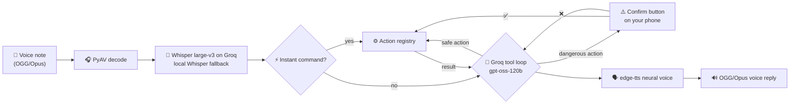
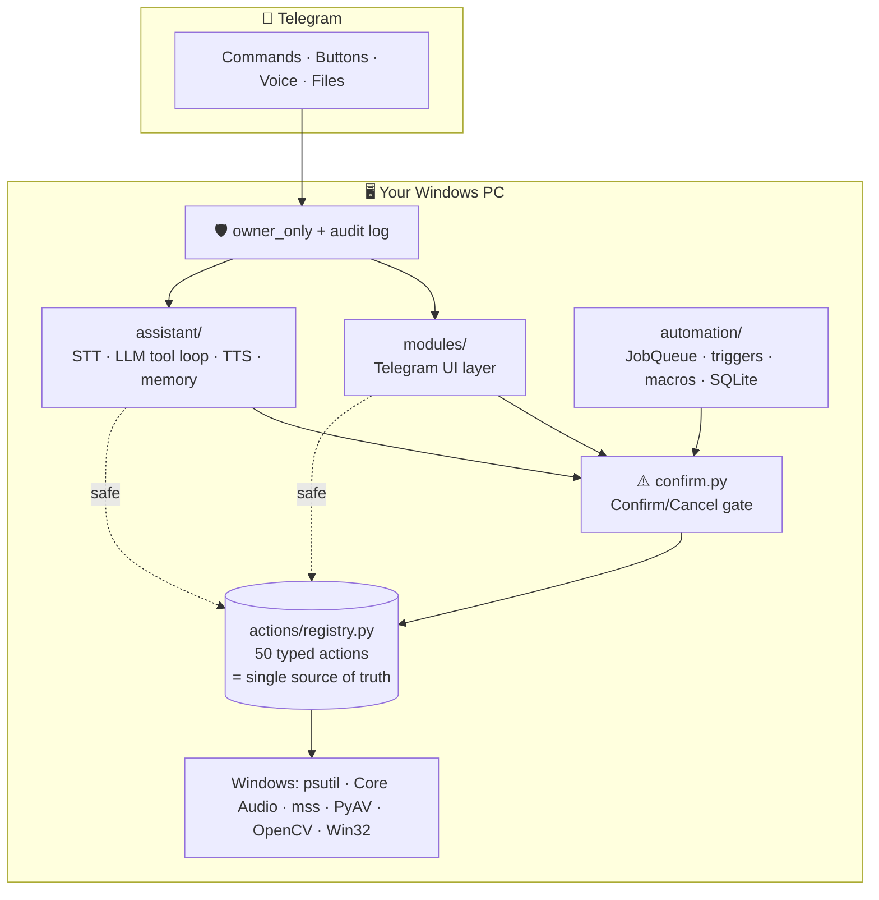

<div align="center">


<br>

**Talk to your PC from anywhere.** Send a voice note: *"Edith, close Chrome, turn the volume down and lock the screen."*<br>
Your PC does it, then answers you out loud.

<br>

[](https://www.python.org/)
[](#-install-in-60-seconds)
[](https://core.telegram.org/bots)
[](https://python-telegram-bot.org/)
[](#-one-key-everything-works)
[](#-development)
[](LICENSE)

[Install](#-install-in-60-seconds) · [Features](#-what-it-can-do) · [Voice mode](#-edith-voice-mode) · [One key](#-one-key-everything-works) · [Commands](#-command-reference) · [Safety](#-security-model) · [FAQ](#-faq)

</div>

---

## ✨ Why Edith?

<table>
<tr>
<td width="33%" valign="top">

### 🎙 Talk, don't type
Send a **voice note**. Edith transcribes it with **Whisper large-v3**, works out the steps, runs them and **replies with her own voice**.

</td>
<td width="33%" valign="top">

### 💬 Just say it or type it
No slash commands needed: plain chat messages and voice notes both work. Common commands run **instantly**, with no AI call.

</td>
<td width="33%" valign="top">

### 🛡 Paranoid by default
Only **your** Telegram account can use it, and strangers get silence. Anything destructive needs a **✅ Confirm** tap, even when the AI asks.

</td>
</tr>
<tr>
<td valign="top">

### ⚡ 52 actions, one registry
Every feature is a typed action. Slash commands, buttons, the AI and automations all call the **same** code.

</td>
<td valign="top">

### ⏰ Automations
Reminders, `/every 30m`, `/at 22:00`, triggers like **`cpu>90 for 2m`** or **`battery<20`**, plus macros. Saved in SQLite, so they survive restarts.

</td>
<td valign="top">

### 🧰 Zero-config install
Double-click `setup.bat`. Python, packages, bot token, **auto-detection of your Telegram ID**: done in one go.

</td>
</tr>
</table>

## 💬 What it feels like

```text
You    🎤 (voice) "Edith, what's eating my RAM? Kill the worst one."
Edith  Chrome is using 6.1 GB across 38 processes. Shall I end it?
       ⚠️ Confirm?  kill_process(target='chrome.exe')   [✅ Confirm] [❌ Cancel]
You    ✅
Edith  🔊 "Done. Chrome is closed, and you've got 9 GB free now."

You    /at 23:30 daily power_shutdown
Edith  ⚠️ Confirm? Schedule power_shutdown daily at 23:30   [✅ Confirm] [❌ Cancel]

You    /when battery<20 notify text=Plug me in
Edith  🔔 Trigger armed: battery < 20%
```
<sub>An illustrative conversation; exact wording varies with the AI model you pick.</sub>

## 🚀 Install in 60 seconds

> **You need:** Windows 10/11 and Telegram on your phone. No Python and no admin rights.

**1.** Download this repo (green **Code** button → *Download ZIP*) or:

```powershell
git clone https://github.com/Arnab-apk/edith.git
cd edith
```

**2.** Double-click **`setup.bat`**. The wizard:

| Step | What happens |
|:---:|---|
| 📦 | Installs [uv](https://docs.astral.sh/uv/), then **Python 3.12** and every package into a local `.venv`. Nothing system-wide. |
| 🤖 | Asks for your bot token: open **[@BotFather](https://t.me/BotFather)** → `/newbot` → paste the token. Checked live with Telegram. |
| 📱 | Tells you to tap **START** on your new bot. Edith **detects your Telegram ID automatically** and locks the bot to you. |
| 🧠 | Asks for one free **Groq key** and tests it live. That key powers the AI brain and voice recognition. |
| 🔒 | Writes `.env` and restricts it to your Windows account. Optionally adds a *visible* autostart entry. |

**3.** Double-click **`start.bat`**, then on your phone send **`/help`**. That's it. 🎉

> 💡 Prefer one icon? Run `toolsuild_exe.bat` once to create **`Edith.exe`** in the folder. Double-click it: the first time it runs setup, after that it starts Edith. `Edith.exe doctor` / `Edith.exe setup` work too.

<details>
<summary><b>Git Bash / terminal users</b></summary>

```bash
./setup.sh          # same installer
./control.bat start # or: .venv/Scripts/python -m bot.cli start
```
</details>

## 🧩 What it can do

| | Area | Highlights |
|:---:|---|---|
| 📊 | **System** | CPU / RAM / GPU (nvidia-smi) / disks / battery / temps / IPs / uptime, top processes, kill, network, open windows |
| 🔌 | **Power** | Lock, sleep, hibernate, restart, shutdown (with an abort window), logoff, monitor off |
| 💻 | **Shell** | `cmd` and PowerShell with timeouts and process-tree kill, per-chat working directory, start programs |
| 📁 | **Files** | Browse with tap-to-open buttons, download (folders auto-zipped, 50 MB cap), upload from your phone, find, Recycle-Bin delete, move |
| 🖥 | **Desktop** | Multi-monitor screenshots, **screen recording to MP4**, webcam photo, clipboard, open URLs, popups, type, hotkeys, mouse |
| 🎵 | **Media** | Volume / mute (Core Audio), media-key buttons, **speak text out loud on the PC** |
| 🎙 | **Edith AI** | Voice notes or `/j`: STT, an LLM tool loop over all actions, spoken reply. Memory, persona, voice on/off |
| ⏰ | **Automation** | Reminders, interval and daily jobs, system triggers with cooldowns, multi-step macros, all persistent |

## 🎙 Edith voice mode



- **Speech-to-text** uses Groq's hosted Whisper large-v3, with a local Whisper model as automatic fallback (set `STT_PROVIDER=local` to keep audio on your PC).
- **Text-to-speech** uses Microsoft neural voices through `edge-tts` (default `en-GB-SoniaNeural`). Pick any voice with `control config set TTS_VOICE …`.
- Edith **never claims an action she didn't run**, and every dangerous tool call stops and waits for your tap.

## 🧠 One key, everything works

Edith uses a single free **Groq** key (from [console.groq.com](https://console.groq.com/keys)) for both halves of voice control:

| Job | Model | Measured |
|---|---|---|
| **Listening** (speech-to-text) | `whisper-large-v3` on Groq | about 0.7 s per voice note |
| **Thinking** (picking actions) | `openai/gpt-oss-120b` on Groq, backup `qwen/qwen3.8-27b` | about 1–4 s per request |
| **Instant commands** | none: "lock my PC", "open brave", "volume 30", "take a screenshot"… are matched on your PC | no AI call at all |

Groq's free tier is rate-limited (about 8,000 tokens per minute for the main model), so Edith sends only the ~10 tools relevant to each request. If Groq is busy it retries once on the backup model, and listening falls back to a local Whisper model. Advanced users can point `LLM_BASE_URL` / `LLM_MODEL` at any OpenAI-compatible server with `control config set`.

## 📖 Command reference

<details>
<summary><b>📊 System and 🔌 Power</b></summary>

| Command | Description |
|---|---|
| `/status` | PC health: CPU, RAM, GPU, disks, battery, temps, IPs, uptime |
| `/procs [cpu\|mem] [limit]` | Top processes |
| `/kill <pid\|name>` | Kill a process ⚠️ |
| `/net` | Network interfaces, traffic and connections |
| `/apps` | Visible application windows |
| `/gpu` | Detailed GPU stats |
| `/power` | Power menu: lock, sleep, hibernate, restart, shutdown, logoff, abort, monitor off ⚠️ |
| `/lock` | Lock the PC ⚠️ |
| `/abort` | Cancel a pending shutdown or restart |
</details>

<details>
<summary><b>💻 Shell and 📁 Files</b></summary>

| Command | Description |
|---|---|
| `/cmd <command>` | Run a cmd.exe command ⚠️ |
| `/ps <command>` | Run a PowerShell command ⚠️ |
| `/cd [path]` / `/pwd` | Change or show the working directory (no argument = quick picks) |
| `/run <path>` | Start a program or open a file ⚠️ |
| `/ls [path]` | List a folder (tap to browse or download) |
| `/get <path>` | Send a file to Telegram (folders are zipped, 50 MB max) |
| `/find <pattern> [folder]` | Find files by name |
| `/rm <path>` | Move to the Recycle Bin ⚠️ |
| `/mkdir <path>` | Create a folder |
| `/mv <src> <dst>` | Move or rename ⚠️ |
| *(send a file or photo)* | Saved to your upload folder on the PC |
</details>

<details>
<summary><b>🖥 Desktop and 🎵 Media</b></summary>

| Command | Description |
|---|---|
| `/screenshot [monitor] [full]` | Screenshot of all monitors |
| `/record <seconds>` | Record the screen (max 60 s) |
| `/webcam` | Take one webcam photo |
| `/clip get` / `/clip set <text>` | Clipboard |
| `/url <http(s) url>` | Open a URL in the PC's browser |
| `/msg <text>` | Show a popup message on the PC |
| `/type <text>` / `/hotkey ctrl+c` | Type text or press keys ⚠️ |
| `/mouse move\|moveby\|click\|right\|double\|scroll` | Mouse control ⚠️ |
| `/volume [0-100\|+N\|-N]` / `/mute [on\|off]` | Volume |
| `/media` | Media-key buttons (play/pause, next, volume) |
| `/say <text>` | Speak text out loud on the PC |
</details>

<details>
<summary><b>🎙 Edith AI</b></summary>

| Command | Description |
|---|---|
| *(voice note)* | Talk to Edith |
| `/j <request>` | Ask Edith in text |
| `/voice on\|off` | Spoken replies on or off |
| `/persona [text\|reset]` | Show or change Edith's personality (safety rules stay locked) |
| `/forget` | Clear conversation memory |
</details>

<details>
<summary><b>⏰ Automation</b></summary>

Steps are `action arg key=value`, using any action name from the registry. Separate several steps with `;`.

| Command | Example |
|---|---|
| `/remind` | `/remind 10m stretch` · `/remind tomorrow 9:00 call mom` |
| `/every` | `/every 30m screenshot` (minimum 1 minute) |
| `/at` | `/at 22:00 power_shutdown` ⚠️ · `/at 9:00 daily notify text=Standup` |
| `/when` | `/when cpu>90 for 2m` · `/when battery<20` · `/when process x.exe starts` |
| `/macro` | `/macro save work: open_url https://github.com; volume level=30` · `/macro run work` |
| `/jobs` / `/cancel <id>` | List or cancel reminders, jobs and triggers |
</details>

⚠️ = asks for a **Confirm** tap before running.

## 🛡 Security model

Edith gives a phone full control of a PC, so security is built into the core, not added later.

- **Owner allowlist.** Every handler, including commands, buttons, voice and files, goes through `@owner_only`. Unknown users get **no reply at all**, so the bot can't be probed, and every attempt is written to `logs/audit.log`.
- **Confirm before danger.** Shell, kill, delete, move, power, typing and mouse actions are flagged `dangerous` in the registry. The Telegram UI, the AI tool loop and automations all have to get a **✅ Confirm** tap (random one-time token, chat-bound, 120 s expiry) before they run.
- **Hard limits, even after Confirm.** Commands that wipe disks, delete Windows or backups, change boot settings, turn off antivirus or the firewall, or add admin accounts are blocked outright (`bot/actions/policy.py`). One mis-tap or misheard voice note can't brick the PC.
- **Your own rules.** `EDITH_SAFE_MODE=1` makes Edith look-only (no dangerous actions at all). `EDITH_DISABLED_ACTIONS=webcam_photo,category:power` switches off specific actions or whole groups. `control doctor` shows what's active.
- **Full audit trail.** Every action that runs or is blocked is logged to `logs/audit.log` with its arguments (secrets redacted).
- **Prompt-injection aware.** Text the AI reads from your PC (files, window titles, command output) can't skip the Confirm step: the check sits in code, not in the prompt.
- **No stealth, ever.** Edith runs in a visible window. Autostart is a normal Task Scheduler entry you turn on yourself (`control autostart on`, removable any time). There's no keylogging, no hiding from Task Manager, no AV evasion.
- **Secrets stay local.** `.env` is git-ignored and readable only by your Windows account.

See [`docs/SECURITY_REVIEW.md`](docs/SECURITY_REVIEW.md) for the full security review.

## 🎛 Control panel

`control.bat` (double-click for a menu):

```text
control setup              # credentials wizard (token, phone link, AI brain, voice)
control start              # run the bot
control doctor             # ✓/✗ health check: token, users, AI brain, GPU, actions, autostart
control config show        # settings (secrets masked)
control config set KEY V   # change one setting
control autostart on|off   # visible Task Scheduler entry at logon
control logs [--audit]     # recent log / security audit log
```

## 🏗 Architecture



```text
bot/
├── actions/       pure async actions (system, power, shell, files, desktop, media, automation) + registry
├── modules/       Telegram commands and buttons that call actions
├── assistant/     voice (speech-to-text, edge-tts), brain (tool loop), instant intents, memory
├── automation/    scheduler, triggers, macros (SQLite)
├── confirm.py     shared Confirm/Cancel gate
├── security.py    owner allowlist + audit log
└── cli.py         control panel / setup wizard
```

Adding a feature means writing one decorated function, and you get an AI tool and automation step for free:

```python
@action("battery", "Battery percentage and charging state.", category="system")
async def battery() -> ActionResult:
    b = await run_blocking(psutil.sensors_battery)
    return ActionResult(text=f"🔋 {b.percent:.0f}% {'charging' if b.power_plugged else 'on battery'}")
```

## 🧪 Development

```powershell
.venv\Scripts\python -m pytest -q          # 512 tests, no network, no real OS actions
.venv\Scripts\python -m bot.cli doctor     # environment check
```

Tests mock every OS call, so the suite never shuts down, locks, types or opens anything on your machine.

## ❓ FAQ

<details><summary><b>Does it work on macOS or Linux?</b></summary>
Not yet. The action layer uses Windows APIs (Core Audio, Win32, Task Scheduler). The registry design makes a port possible, and PRs are welcome.
</details>

<details><summary><b>Do I need a GPU?</b></summary>
No. Speech-to-text uses CUDA when an NVIDIA GPU is available and falls back to CPU automatically. <code>control doctor</code> shows which one is in use.
</details>

<details><summary><b>Can someone else control my PC if they find my bot?</b></summary>
No. Only Telegram user IDs in <code>ALLOWED_USER_IDS</code> are served. Everyone else gets silence and an entry in the audit log. Keep your bot token private; if it leaks, revoke it in @BotFather (<code>/revoke</code>) and run <code>control setup</code>.
</details>

<details><summary><b>Is it really free?</b></summary>
Yes on Groq's free tier, which is rate-limited rather than unlimited. Instant commands and slash commands never use it.
</details>

<details><summary><b>How do I stop it?</b></summary>
Close the Edith window (or press Ctrl+C). To stop autostart: <code>control autostart off</code>.
</details>

## 🗺 Roadmap

- [x] System, power, shell, files, desktop and media control
- [x] Edith voice mode with pluggable AI brains
- [x] Automations: reminders, jobs, triggers, macros
- [x] One-click installer and control panel
- [ ] 🖥 **Live remote desktop** inside Telegram (Mini App, streamed over a secure tunnel)
- [ ] System-tray icon
- [ ] macOS / Linux action backends

## 🤝 Contributing

Issues and PRs are welcome. Read [CONTRIBUTING.md](CONTRIBUTING.md) and keep its hard rules: every handler `@owner_only`, destructive actions `dangerous=True`, no stealth features, and tests that never touch the real OS.

## 📜 License

[MIT](LICENSE) © 2026 Arnab

<div align="center"><sub>Edith is an independent project and is not affiliated with Marvel or Disney.</sub></div>
